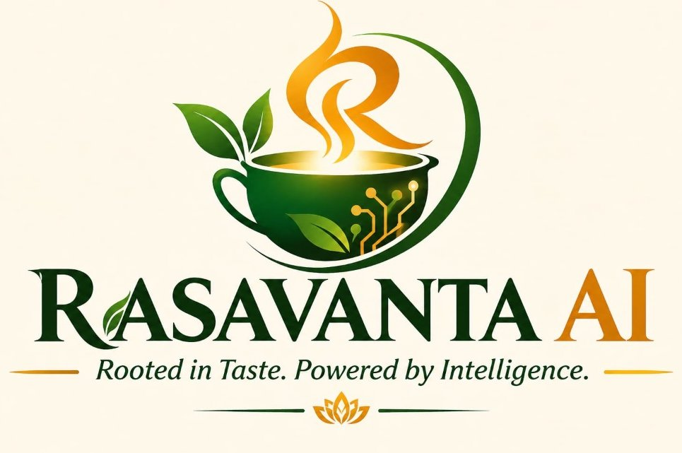

# RASAVANTA AI — Rooted in Taste. Powered by Intelligence.

> An intelligent, multilingual AI-powered cooking, recipe discovery, and zero-waste kitchen management platform.



---

## 1. Product Identity & Philosophy

- **Rasa (రస / रस):** Ancient Sanskrit concept embodying taste, essence, flavour, and digestive harmony (Ayurvedic Shad-Rasa).
- **Vanta (వంట):** Inspired by the Telugu word for the noble craft of cooking.
- **Tagline:** *Rooted in Taste. Powered by Intelligence.*
- **Core Mission:** Empower home cooks to transform existing pantry ingredients into culinary delicacies, eliminate household food waste, and discover regional culinary heritage in their native language.

---

## 2. Official Brand Design System

### Color Palette
| Color | Hex | Role |
|---|---|---|
| **Forest Green** | `#244B39` | Primary Brand Color, CTAs, Dominant Identity |
| **Warm Ivory** | `#F5F0E5` | Editorial Background, Page Foundation |
| **Turmeric Gold** | `#D99A38` | Accent Highlights, Star Ratings, Timers |
| **Sage Green** | `#A7B99A` | Subtle Borders, Badges, Secondary Accents |
| **Terracotta** | `#D97556` | Warning/Alerts, Calorie Badges, Warm Highlights |
| **Charcoal** | `#303A32` | High-contrast Body Typography |
| **Pure White** | `#FFFFFF` | Card Surfaces, Form Inputs |

### Typography
- **Headings & Editorial Titles:** `DM Serif Display`
- **User Interface & Body Text:** `Manrope`
- **Native Script Cascading Fonts:**
  - Telugu: `Noto Sans Telugu`
  - Hindi & Marathi: `Noto Sans Devanagari`
  - Tamil: `Noto Sans Tamil`
  - Kannada: `Noto Sans Kannada`
  - Malayalam: `Noto Sans Malayalam`
  - Bengali: `Noto Sans Bengali`
  - Gujarati: `Noto Sans Gujarati`

---

## 3. Technology Stack

- **Frontend Core:** React 19, Vite 6, JavaScript (ES Modules, JSX)
- **Styling:** Tailwind CSS v4 with custom theme tokens & CSS variables
- **Routing:** React Router DOM (v7)
- **State Management:** React Context API (`AuthContext`, `RecipeContext`, `PantryContext`)
- **Animations:** Framer Motion (Page reveals, staggered cards, drawer menus, cooking mode transitions)
- **Interactive Carousels:** Embla Carousel (`embla-carousel-react`)
- **Analytics Charts:** Recharts (Macronutrient Donut, Weekly Intake Trends, RDA Bar Comparison, Activity Sessions)
- **Multilingual Support:** `i18next` & `react-i18next` with 9 individual JSON translation sets
- **Notifications:** React Hot Toast with custom branded toasts
- **Celebration Effects:** Canvas Confetti

---

## 4. Multilingual Experience (9 Supported Languages)

RASAVANTA AI provides complete native translations across all navigation items, hero titles, buttons, filter options, pantry tables, cooking instructions, and dashboard metrics:

1. **English** (`en`)
2. **తెలుగు — Telugu** (`te`)
3. **हिन्दी — Hindi** (`hi`)
4. **தமிழ் — Tamil** (`ta`)
5. **ಕನ್ನಡ — Kannada** (`kn`)
6. **മലയാളം — Malayalam** (`ml`)
7. **বাংলা — Bengali** (`bn`)
8. **ગુજરાતી — Gujarati** (`gu`)
9. **मराठी — Marathi** (`mr`)

- Selected language is saved in `localStorage` (`rasavanta_lang`) and synchronized with `document.documentElement.lang`.
- Instant switching via the globe dropdown in the main navigation.

---

## 5. Complete Application Pages (8 Distinct Pages)

### Page 1 — Home (`/`)
- Hero section with the official logo, editorial typography, and quick call-to-actions.
- Interactive ingredient search with quick-tap chips that transfer to the AI Kitchen.
- Featured Recipe Carousel powered by Embla Carousel.
- Regional cuisine cards (Andhra, Hyderabadi, Chettinad, Kerala, Punjabi, Bengali, Gujarati, Maharashtrian).
- "How RASAVANTA AI Works" 3-step visual walkthrough.
- Smart Pantry promotion banner with zero-waste metrics (₹4,200 saved, 12 kg waste reduced).
- Nutritional wisdom guide (Ayurvedic Shad-Rasa balance, macro tracking, intelligent swaps).
- Recommended recipes grid and authentic customer testimonials.
- Comprehensive brand footer.

### Page 2 — Explore Recipes (`/recipes`)
- Search bar across dish titles, spices, ingredients, and regional cuisines.
- Desktop filter sidebar & responsive mobile drawer:
  - Cuisines filter
  - Dietary preferences (Vegetarian, Vegan, Gluten-Free, Non-Veg)
  - Max cooking time slider (≤ 15 min to ≤ 60 min)
  - Difficulty level (Beginner Friendly, Intermediate, Master Chef)
  - Sorting (Top Rated, Fastest Cook Time, Lowest Calories)
- Embla carousel banner of chef's selections.
- Clean empty states and reset button.

### Page 3 — AI Kitchen / RasaGen (`/ai-kitchen`)
- **Left Panel (Workspace):**
  - Add/remove ingredient chips
  - Quick-add suggestions
  - **Pantry Sync:** One-click import of ingredients currently stocked in the user's Smart Pantry
  - Target cuisine, dietary lifestyle, allergies & dislikes filter
  - Target cooking time and servings counter
  - **Output Language Selector:** Instructs the future Gemini backend to respond in the chosen regional language
- **Right Panel (Results):**
  - Animated culinary thinking state ("Analyzing flavor compounds...", "Balancing Ayurvedic rasas...")
  - Top AI Match card with ingredient match percentage
  - Ingredient checklist and preparation preview
  - Save to Cookbook and View Cooking Method buttons
  - Alternative recipe matches
  - Clearly labelled **Demo Mode** notice ready for `POST /api/v1/recipes/generate`.

### Page 4 — Recipe Details (`/recipes/:id`)
- Digital cooking magazine aesthetic with high-resolution food photography.
- Native regional title display.
- Servings scaler with automatic ingredient quantity recalculation.
- Interactive ingredient checklist with strike-through and completion checkboxes.
- Tested ingredient substitutions guide for missing pantry items.
- Macronutrient profile cards (Protein, Carbs, Fats, Fiber).
- **Interactive Cooking Mode:**
  - Full-screen distraction-free companion mode for kitchen counters
  - Step progress bar and step counter
  - Interactive step countdown timer (Start, Pause, Reset) with audio/toast alerts
  - Previous and Next step controls
  - Confetti celebration upon finishing the recipe!

### Page 5 — Smart Pantry (`/pantry`)
- Comprehensive kitchen inventory management.
- Add, Edit, and Delete pantry items with modal forms.
- Quantity, unit, storage location (Refrigerator, Freezer, Pantry Shelf, Countertop, Spice Rack), purchase date, and expiry date.
- Real-time expiry calculations:
  - Good condition (Fresh)
  - Expiring soon (Within 3 days) with visual badge
  - Expired / Urgent indicator
- **Cook Expiring Items:** One-click transfer of items nearing expiration into RasaGen to eliminate spoilage!
- LocalStorage persistence with seamless offline demo synchronization.

### Page 6 — My Cookbook (`/cookbook`)
- Pinterest-inspired personal recipe sanctuary with varied aspect card proportions.
- Tabs for "All Saved" and "Favorites Only".
- Real-time search across saved recipes.
- Quick actions: Remove recipe, toggle favorite, and direct navigation to cooking.

### Page 7 — Dashboard (`/dashboard`)
- Executive analytics dashboard featuring **5 Recharts visualizations**:
  1. *Macronutrient Distribution (Donut Chart)*: Protein, Carbs, Fats, Fiber breakdown.
  2. *Weekly Calorie & Protein Intake Trends (Line Chart)*: Daily tracking from Monday to Sunday.
  3. *Nutrient Fulfillment (Bar Chart)*: Iron, Calcium, Vitamin C, Potassium, Magnesium vs. RDA targets.
  4. *Weekly Cooking Activity (Bar Chart)*: Home culinary sessions recorded per day.
  5. *Pantry Health Breakdown*: Active fresh vs. expiring inventory balance.
- Clear sample data indicator ensuring academic and industry honesty.

### Page 8 — Authentication: Login & Register (`/login`, `/register`)
- Branded authentication interfaces featuring the official RASAVANTA AI logo.
- Client-side validation: email regex, password minimum length, confirm password match.
- Show / Hide password eye toggle.
- **One-Click Demo Chef Login** for instantaneous reviewer evaluation without typing credentials.
- Service architecture ready for JWT token storage and bearer header injection.

---

## 6. Architecture & Folder Structure

```text
RASAVANTA-AI/
client/
├── public/
│   ├── brand/
│   │   └── rasavanta-logo.png      # Official RASAVANTA AI Brand Logo
│   ├── favicon.png
│   └── favicon.ico
│
├── src/
│   ├── assets/
│   ├── components/
│   │   ├── carousel/
│   │   │   └── RecipeCarousel.jsx  # Embla Carousel implementation
│   │   ├── navigation/
│   │   │   ├── Navbar.jsx          # Responsive navbar with drawer & logo
│   │   │   ├── Footer.jsx          # Cultural heritage & cuisine footer
│   │   │   └── LanguageSelector.jsx# 9-language native dropdown
│   │   ├── pantry/
│   │   │   └── PantryItemModal.jsx # Add/Edit grocery item modal
│   │   └── recipe/
│   │       └── RecipeCard.jsx      # Animated card with favorites & tags
│   │
│   ├── context/
│   │   ├── AuthContext.jsx         # User state & JWT persistence
│   │   ├── PantryContext.jsx       # Inventory state & expiry metrics
│   │   └── RecipeContext.jsx       # Favorites & Cookbook collection
│   │
│   ├── data/
│   │   ├── cuisinesData.js         # Regional cuisine metadata
│   │   ├── pantryData.js           # Seed pantry items with dynamic dates
│   │   └── recipesData.js          # Authentic regional recipe collection
│   │
│   ├── i18n/
│   │   └── index.js                # i18next configuration & language registry
│   │
│   ├── locales/
│   │   ├── en/translation.json     # English
│   │   ├── te/translation.json     # Telugu (తెలుగు)
│   │   ├── hi/translation.json     # Hindi (हिन्दी)
│   │   ├── ta/translation.json     # Tamil (தமிழ்)
│   │   ├── kn/translation.json     # Kannada (ಕನ್ನಡ)
│   │   ├── ml/translation.json     # Malayalam (മലയാളം)
│   │   ├── bn/translation.json     # Bengali (বাংলা)
│   │   ├── gu/translation.json     # Gujarati (ગુજરાતી)
│   │   └── mr/translation.json     # Marathi (मराठी)
│   │
│   ├── pages/
│   │   ├── AIKitchen.jsx           # RasaGen interactive studio
│   │   ├── Dashboard.jsx           # Recharts culinary analytics
│   │   ├── Explore.jsx             # Recipe catalog with multi-filters
│   │   ├── Home.jsx                # Premium landing page
│   │   ├── Login.jsx               # Auth login
│   │   ├── MyCookbook.jsx          # Pinterest-style saved recipes
│   │   ├── RecipeDetails.jsx       # Digital magazine & cooking mode
│   │   ├── Register.jsx            # Auth registration
│   │   └── SmartPantry.jsx         # Kitchen inventory & expiry tracker
│   │
│   ├── services/
│   │   ├── api.js                  # Centralized Axios instance with bearer interceptors
│   │   ├── authService.js          # Authentication API service
│   │   ├── pantryService.js        # Pantry inventory API service
│   │   └── recipeService.js        # RasaGen recipe generation & catalog API service
│   │
│   ├── App.jsx                     # Route registry with scroll-to-top
│   ├── main.jsx                    # React 19 entry point with Context Providers
│   └── index.css                   # Tailwind v4 theme & font cascade
│
├── .env.example
├── package.json
└── vite.config.js
```

---

## 7. Backend-Ready API Integration

The frontend is architected to seamlessly interface with an Express/Node.js backend, MongoDB Atlas, and Google Gemini AI API:

- **Base URL:** Configured via `VITE_API_BASE_URL` in `.env` (defaults to `http://localhost:5000/api/v1`).
- **Endpoint Contracts:**
  - `POST /recipes/generate` — Sends ingredient list, cuisine, dietary restriction, output language, max cook time, and servings. Receives structured recipe object.
  - `GET /recipes` — Retrieves paginated, filtered recipe lists.
  - `GET /recipes/:id` — Retrieves detailed recipe by ID.
  - `POST /recipes/:id/favorite` — Toggles favorite status.
  - `GET /pantry` — Retrieves logged-in user's pantry inventory.
  - `POST /pantry` — Adds new pantry item.
  - `PUT /pantry/:id` — Updates existing pantry item.
  - `DELETE /pantry/:id` — Removes item from inventory.
  - `POST /auth/login` — Authenticates user and returns JWT bearer token.
  - `POST /auth/register` — Registers user profile.

---

## 8. Installation & Development Commands

### Prerequisites
- Node.js (v18+ or v20+ recommended; verified on Node v24.21.0)
- npm (v9+ or v10+)

### Setup
```bash
# Clone or navigate to the workspace
cd "Rasavanta AI"

# Install all dependencies
npm --prefix client install
```

### Running the Development Server
```bash
# Start Vite development server
npm run dev

# Alternatively, from within the client folder:
cd client
npm run dev
```

Open your browser at `http://localhost:5173`.

### Production Build
```bash
# Build optimized production bundle
npm run build

# Preview production build locally
npm run preview
```

---

## 9. Deliverables Verification Summary

| Feature / Requirement | Status | Notes |
|---|---|---|
| Official Brand Logo Integration | Complete | Rendered in Navbar, Footer, Auth pages from `public/brand/rasavanta-logo.png` |
| 9-Language Multilingual Interface | Complete | Real translations for EN, TE, HI, TA, KN, ML, BN, GU, MR |
| Page 1: Home | Complete | Hero, ingredient chips, carousel, cuisines, works, pantry promo, testimonials |
| Page 2: Explore Recipes | Complete | Search, cuisine & diet filters, time slider, difficulty, sorting, carousel |
| Page 3: AI Kitchen (RasaGen) | Complete | Ingredient workspace, pantry import, animated thinking, match score, demo notice |
| Page 4: Recipe Details | Complete | Servings scaler, checklist, interactive cooking mode with live timer & confetti |
| Page 5: Smart Pantry | Complete | CRUD modal, expiry tracking (fresh/soon/expired), "Cook Expiring" button |
| Page 6: My Cookbook | Complete | Masonry Pinterest layout, favorites tab, instant search, removal controls |
| Page 7: Dashboard | Complete | 5 Recharts visualizations, weekly trend, macro donut, RDA bar, sample notice |
| Page 8: Authentication | Complete | Form validation, eye toggle, one-click demo login, JWT-ready service |
| Embla Carousel & Motion | Complete | Smooth dragging, touch support, pagination dots, Framer Motion transitions |
| Production Build Verification | Complete | Zero build errors (`vite build` succeeded with code 0) |

---

*RASAVANTA AI — Rooted in Taste. Powered by Intelligence.*
# Rasavanta-ai

