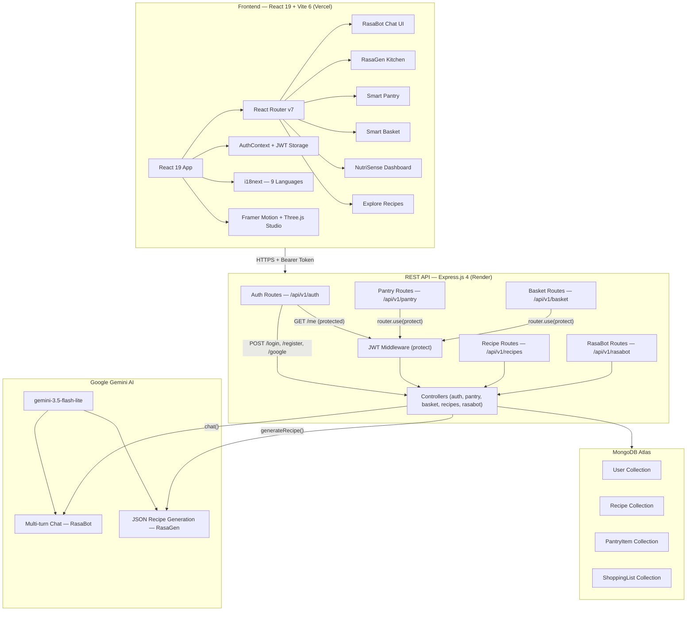

<div align="center">


# RASAVANTA AI

### *Rooted in Taste. Powered by Intelligence.*

**An Intelligent Culinary Platform for Smarter Cooking, Recipe Discovery & Sustainable Kitchens**

<br/>

[](https://rasavanta-ai.vercel.app/)
[](https://rasavanta-ai.onrender.com/api/health)
[](https://github.com/shareen2006/Rasavanta-ai)

<br/>

[](https://react.dev/)
[](https://vitejs.dev/)
[](https://nodejs.org/)
[](https://www.mongodb.com/atlas)
[](https://ai.google.dev/)
[](https://jwt.io/)
[](https://tailwindcss.com/)
[](https://vercel.com/)

</div>

---

## 📌 Table of Contents

- [Project Overview](#project-overview)
- [Problem Statement](#problem-statement)
- [Our Solution](#our-solution)
- [Key Features](#key-features)
- [Application Modules](#application-modules)
- [AI Integration](#ai-integration--intelligence)
- [System Architecture](#system-architecture)
- [Technology Stack](#technology-stack)
- [Frontend Architecture](#frontend-architecture)
- [Backend Architecture](#backend-architecture)
- [Database Design](#database-design--mongodb-integration)
- [Authentication & Security](#authentication--security)
- [Google Gemini AI Integration](#google-gemini-ai-integration)
- [Project Structure](#project-folder-structure)
- [Application Screenshots](#application-screenshots)
- [Installation & Setup](#installation--local-setup)
- [Environment Variables](#environment-variables-configuration)
- [Running the Application](#running-the-application)
- [API Documentation](#api-documentation)
- [Deployment](#deployment-architecture)
- [Future Enhancements](#future-enhancements)
- [Contributing](#contributing-guidelines)
- [License](#license)
- [Developer](#developer--contact)

---

## 🌿 Project Overview

**RASAVANTA AI** is a full-stack, AI-powered culinary intelligence platform built for the modern Indian kitchen. It bridges the gap between traditional Indian cooking wisdom and cutting-edge artificial intelligence — enabling users to discover recipes, manage their pantry, plan meals, and receive real-time culinary guidance, all within a seamless, multilingual experience.

The platform serves as a smart kitchen companion: understanding what ingredients a user has, suggesting contextually relevant dishes, generating brand-new recipes on demand, tracking nutrition, managing shopping, and offering conversational support through an AI-powered chef assistant — in any of 9 Indian languages.

---

## 🔍 Problem Statement

Indian home cooks face several persistent challenges:

- **Ingredient waste** due to no visibility of what is in the pantry and what is about to expire.
- **Recipe decision fatigue** — knowing which dishes can be made with the ingredients on hand.
- **Nutritional blind spots** — difficulty tracking macronutrient and micronutrient intake across meals.
- **Lack of multilingual culinary resources** — mainstream apps rarely support regional Indian languages.
- **Disconnected tools** — pantry, shopping list, meal planning, and recipe apps are all separate.
- **No personalized AI guidance** — existing recipe apps are static; they cannot answer follow-up questions, adapt to user constraints, or troubleshoot cooking in real-time.

---

## 💡 Our Solution

RASAVANTA AI is a unified, intelligent culinary ecosystem that solves every one of these problems:

| Challenge | RASAVANTA AI Solution |
|---|---|
| Ingredient waste | Smart Pantry with expiry tracking and alerts |
| Recipe discovery | Pan-India recipe database with AI-powered filtering |
| AI-generated recipes | RasaGen synthesizes recipes from user pantry ingredients |
| Nutritional awareness | NutriSense dashboard with macro/micro nutrient tracking |
| Multilingual support | Full i18n in 9 Indian languages |
| Conversational cooking help | RasaBot — Gemini-powered AI chef assistant |
| Shopping management | Smart Basket with JWT-secured per-user data |
| Meal planning | Dedicated interactive meal planner module |
| Sustainable cooking | Pantry-first recipe suggestions to reduce food waste |

---

## ✨ Key Features

| Feature | Description |
|---|---|
| 🤖 **RasaBot AI Chef** | Multi-turn conversational AI assistant powered by Google Gemini with 12-turn memory |
| 🧑‍🍳 **RasaGen Recipe Synthesis** | AI-generated recipes with full nutritional schema from pantry ingredients |
| 🧊 **Smart Pantry** | CRUD pantry manager with per-user data isolation and expiry tracking |
| 🛒 **Smart Basket** | JWT-protected shopping list with server-side user identity enforcement |
| 📊 **NutriSense Dashboard** | Interactive recharts visualization of macro and micronutrient intake |
| 📚 **Digital Cookbook** | Save, organize, and revisit favorite and AI-generated recipes |
| 🗓️ **Meal Planner** | Weekly meal planning interface |
| 🌐 **Multilingual (i18n)** | 9 Indian languages: Telugu, Hindi, Tamil, Kannada, Malayalam, Bengali, Marathi, Gujarati, English |
| 🎥 **YouTube Tutorial Integration** | Embedded cooking tutorials linked to recipe pages |
| 🔐 **Production Security** | JWT + bcrypt authentication with strict per-user ownership enforcement |
| 🌍 **Google Sign-In** | OAuth 2.0 Google authentication via `google-auth-library` |
| 📱 **Responsive Design** | Mobile-first adaptive layout with Framer Motion animations |
| 🎨 **3D Cooking Studio** | Interactive Three.js 3D cooking environment |

---

## 🧩 Application Modules

### 🤖 RasaBot — AI Culinary Companion
An intelligent multi-turn conversational assistant that understands Indian cooking deeply. RasaBot can suggest recipes from available ingredients, troubleshoot dishes, explain food science, provide substitutions, scale portions, and respond fluently in 9 Indian languages.

### 🧑‍🍳 RasaGen — AI Kitchen
An AI recipe synthesizer that takes a user's available pantry ingredients, cuisine preference, dietary restrictions, meal type, and time constraints, then generates a complete, authentic, production-quality recipe with full nutritional data, substitutions, and chef tips.

### 🧊 Smart Pantry
A per-user pantry management system. Users can add, update, and delete pantry items with quantities, units, locations, and expiry dates. The pantry context powers RasaBot and RasaGen with live ingredient awareness.

### 🛒 Smart Basket
A JWT-secured shopping list module. User identity is derived exclusively from the verified JWT token — never from client-supplied parameters — preventing all IDOR attacks.

### 📊 NutriSense
An interactive nutrition analytics dashboard built with Recharts: macro distribution (donut), weekly calorie/protein trends (line), micronutrient target vs. actual (bar), pantry health status (donut), and cooking activity (bar).

### 📚 Digital Cookbook
A personal recipe collection page where users can browse, save, and manage their favorite and AI-generated recipes.

### 🗓️ Meal Planner
A weekly meal planning interface for organizing breakfast, lunch, and dinner across the week.

### 🌐 Explore Recipes
A filterable, searchable recipe database featuring Pan-India dishes with cuisine filters, dietary filters, difficulty levels, and YouTube tutorial links.

---

## 🧠 AI Integration & Intelligence

RASAVANTA AI deeply integrates **Google Gemini AI** (`gemini-3.5-flash-lite`) via the official `@google/genai` SDK:

### RasaBot Intelligence
- **Multi-turn memory**: Maintains up to 12 conversation turns in native Gemini contents format
- **Contextual awareness**: Receives user's current pantry ingredients and dietary preferences
- **Dynamic suggestions**: Generates contextual follow-up suggestions per conversation state
- **Recipe card linking**: Automatically matches conversation output to catalog recipes
- **Rate-limit protection**: 400ms minimum request spacing with exponential backoff on 429/503
- **Timeout guard**: 45-second timeout wrapper on all Gemini API calls

### RasaGen Intelligence
- **Structured JSON output**: Returns `responseMimeType: 'application/json'` for guaranteed schema
- **Nutrition sourcing**: ICMR-NIN Indian Food Composition Tables (IFCT) & USDA FoodData Central
- **Native language titles**: Recipes returned with Telugu, Hindi, and Tamil native name fields
- **Allergen & dietary classification**: Vegan, gluten-free, Jain-friendly flags included
- **Image prompt synthesis**: Generates photorealistic food photography prompts for each dish

### Language Support
RasaBot detects and responds in: **Telugu · Hindi · Tamil · Kannada · Malayalam · Bengali · Marathi · Gujarati · English**

---

## 🏗️ System Architecture



---

## 🛠️ Technology Stack

### Frontend
| Technology | Version | Purpose |
|---|---|---|
| React | 19.0 | UI framework |
| Vite | 6.1 | Build tool and dev server |
| Tailwind CSS | 4.0 | Utility-first CSS framework |
| Framer Motion | 12.4 | Animations and transitions |
| React Router DOM | 7.1 | Client-side routing |
| Recharts | 2.15 | Data visualization charts |
| Three.js | 0.187 | 3D interactive cooking studio |
| Lucide React | 0.475 | Icon library |
| react-i18next | 15.4 | Internationalization (9 languages) |
| i18next | 24.2 | i18n core |
| Axios | 1.7 | HTTP client |
| react-hot-toast | 2.5 | Toast notifications |
| Embla Carousel | 8.5 | Carousel component |
| canvas-confetti | 1.9 | Celebration animations |

### Backend
| Technology | Version | Purpose |
|---|---|---|
| Node.js | LTS | Runtime |
| Express.js | 4.19 | Web framework |
| Mongoose | 8.4 | MongoDB ODM |
| @google/genai | 3.5 | Official Google Gemini SDK |
| jsonwebtoken | 9.0 | JWT signing and verification |
| bcryptjs | 3.0 | Password hashing |
| google-auth-library | 11.3 | Google OAuth 2.0 |
| cors | 2.8 | Cross-Origin Resource Sharing |
| morgan | 1.10 | HTTP request logging |
| dotenv | 16.4 | Environment variable management |
| resend | 6.38 | Transactional email |
| axios | 1.21 | Server-side HTTP requests |
| nodemon | 3.1 | Development hot reload |

### Infrastructure
| Service | Purpose |
|---|---|
| MongoDB Atlas | Cloud-hosted NoSQL database |
| Vercel | Frontend hosting and CDN |
| Render | Backend API hosting |
| Google Gemini API | AI language model |

---

## 🎨 Frontend Architecture

The React frontend follows a **context-based state management** pattern:

```
client/src/
├── context/
│   ├── AuthContext.jsx         # JWT auth state, login/logout/register
│   ├── NavigationContext.jsx   # Active route & navigation tracking
│   ├── PantryContext.jsx       # Per-user pantry state and stats
│   └── RecipeContext.jsx       # Recipe catalog, favorites, saved
├── pages/
│   ├── Home.jsx                # Landing page
│   ├── Explore.jsx             # Recipe discovery and filtering
│   ├── RecipeDetails.jsx       # Individual recipe view + YouTube
│   ├── AIKitchen.jsx           # RasaGen recipe generation
│   ├── SmartPantry.jsx         # Pantry CRUD management
│   ├── MyCookbook.jsx          # Saved recipe collection
│   ├── MealPlanner.jsx         # Weekly meal planning
│   ├── SmartBasketPage.jsx     # Shopping list
│   ├── NutriSensePage.jsx      # Nutrition analytics
│   ├── RasaBotPage.jsx         # AI chat interface
│   ├── Dashboard.jsx           # Analytics overview with charts
│   ├── Login.jsx               # Auth — login
│   └── Register.jsx            # Auth — registration
├── services/
│   ├── api.js                  # Axios client with Bearer injection & 401 token purge
│   └── authService.js          # Authentication API calls
└── components/                 # Shared UI components
```

**Routing** is handled by React Router DOM v7 with the following public and protected routes:

| Path | Page | Auth Required |
|---|---|---|
| `/` | Home | No |
| `/recipes` | Explore Recipes | No |
| `/recipes/:id` | Recipe Details | No |
| `/ai-kitchen` | RasaGen AI Kitchen | No |
| `/rasabot` | RasaBot Chat | No |
| `/pantry` | Smart Pantry | Yes |
| `/basket` / `/smart-basket` | Smart Basket | Yes |
| `/cookbook` | My Cookbook | Yes |
| `/meal-planner` | Meal Planner | Yes |
| `/nutrisense` | NutriSense | Yes |
| `/dashboard` | Dashboard | Yes |
| `/login` | Login | No |
| `/register` | Register | No |

---

## ⚙️ Backend Architecture

The Express.js backend follows an **MVC pattern** with layered middleware:

```
server/src/
├── app.js                      # Express app, CORS, middleware, route mounting
├── server.js                   # Entry point — DB connect, port listen
├── config/
│   └── db.js                   # MongoDB Atlas connection with Mongoose
├── middleware/
│   └── authMiddleware.js       # JWT verification (HS256, fail-secure)
├── controllers/
│   ├── authController.js       # Register, login, /me, Google OAuth
│   ├── pantryController.js     # Pantry CRUD with per-user isolation
│   ├── shoppingListController.js  # Basket with JWT-enforced ownership
│   ├── recipeController.js     # Recipe listing, filtering, AI generation
│   └── rasabotController.js    # RasaBot chat endpoint
├── models/
│   ├── User.js                 # User schema with bcrypt hashed passwords
│   ├── PantryItem.js           # Pantry item with userId ownership
│   ├── Recipe.js               # Recipe catalog schema
│   └── ShoppingList.js         # Shopping list with userId
├── routes/
│   ├── authRoutes.js           # /api/v1/auth/*
│   ├── pantryRoutes.js         # /api/v1/pantry/* (protected)
│   ├── shoppingListRoutes.js   # /api/v1/basket/* (protected)
│   ├── recipeRoutes.js         # /api/v1/recipes/* (public)
│   └── rasabotRoutes.js        # /api/v1/rasabot/* (public)
├── services/
│   ├── geminiService.js        # Google Gemini SDK wrapper
│   └── recipeImageService.js   # Recipe image resolution
├── scripts/
│   └── migrate_passwords.js    # Dry-run password migration helper
└── seed/
    ├── seedData.json           # Pan-India recipe catalog
    └── seedRecipes.js          # Database seeding script
```

---

## 🗄️ Database Design & MongoDB Integration

RASAVANTA AI uses **MongoDB Atlas** (`cluster0.sd4gg6y.mongodb.net`) with the `rasavanta_ai` database.

### Collections

#### User (`models/User.js`)
```js
{
  id: String,                  // Unique slug (e.g., 'usr-1740540000000', indexed)
  name: String,                // Full user name (required)
  email: String,               // Unique, lowercase, indexed
  password: String,            // bcrypt hash (10 salt rounds; required for 'local')
  googleId: String,            // Google OAuth subject ID (sparse index)
  authProvider: String,        // 'local' | 'google'
  role: String,                // Default: 'Home Chef'
  avatar: String,              // Profile image URL
  favoriteRecipes: [String],   // Array of saved recipe slug IDs
  preferences: {
    cuisine: String,           // Default: 'All'
    diet: String,              // Default: 'All'
    language: String           // Default: 'en'
  },
  createdAt: Date,             // Mongoose timestamps
  updatedAt: Date
}
```

#### PantryItem (`models/PantryItem.js`)
```js
{
  id: String,                  // Unique item slug (indexed)
  userId: String,              // Owner reference strictly enforced (indexed)
  name: String,                // Ingredient name (e.g., 'Malai Paneer', indexed)
  category: String,            // 'Vegetables' | 'Dairy' | 'Lentils' | etc.
  quantity: Number,            // Item quantity (default: 1)
  unit: String,                // 'kg', 'g', 'bunch', 'portion', etc.
  purchaseDate: String,        // YYYY-MM-DD
  expiryDate: String,          // YYYY-MM-DD (indexed for freshness queries)
  location: String,            // 'Refrigerator' | 'Freezer' | 'Pantry Shelf' | 'Countertop' | 'Spice Rack'
  createdAt: Date,             // Mongoose timestamps
  updatedAt: Date
}
```

#### ShoppingList (`models/ShoppingList.js`)
```js
{
  id: String,                  // Unique basket slug (indexed)
  userId: String,              // JWT-derived user identity (indexed)
  name: String,                // Default: 'Smart Basket'
  items: [{
    id: String,                // Item slug
    name: String,              // Item name
    quantity: String,          // Quantity string (e.g., '250', '2')
    unit: String,              // 'g', 'kg', 'portion', etc.
    category: String,          // 'Produce', 'Pantry Staples', etc.
    checked: Boolean,          // Completion toggle (default: false)
    inPantry: Boolean,         // Whether present in user's pantry
    sourceRecipes: [String]    // Recipe IDs that generated this item
  }],
  createdAt: Date,             // Mongoose timestamps
  updatedAt: Date
}
```

#### Recipe (`models/Recipe.js`)
```js
{
  id: String,                  // Slug identifier
  title: String,
  description: String,
  cuisine: String,
  region: String,
  diet: String,
  mealType: String,
  prepTime: Number,
  cookTime: Number,
  servings: Number,
  calories: Number,
  nutrition: Object,
  ingredients: Array,
  instructions: Array,
  image: String,
  rating: Number,
  tags: Array
}
```

---

## 🔐 Authentication & Security

RASAVANTA AI implements a production-grade security layer with the following measures:

### Authentication Flow

```
Register → bcrypt hash (10 rounds) → store in MongoDB
Login    → bcrypt compare → sign JWT (HS256, 7d expiry) → return token
Request  → Bearer token → JWT verify → req.user → controller
```

### Security Implementation

| Control | Implementation |
|---|---|
| **Password hashing** | bcryptjs with 10 salt rounds |
| **JWT signing** | HS256 algorithm, 7-day expiry, subject = userId |
| **Secret validation** | Server refuses to start if `JWT_SECRET` < 32 chars |
| **Middleware enforcement** | `protect` middleware on all pantry and basket routes |
| **Ownership enforcement** | All queries filter by `userId` from verified JWT |
| **IDOR prevention** | Server never trusts client-supplied userId |
| **Google OAuth** | `google-auth-library` token verification |
| **Error responses** | Sanitized — never exposes stack traces or hashes |
| **Legacy migration** | JIT bcrypt upgrade on first login for old plain-text passwords |
| **Token exposure** | Tokens never logged or included in error responses |

### Security Test Results
- ✅ **30/30** local security assertions passed
- ✅ **23/23** live MongoDB Atlas security checks passed

---

## 🤖 Google Gemini AI Integration

RASAVANTA AI integrates Google Gemini AI via the **official `@google/genai` SDK v3.5**.

### Model Configuration
- **Primary model**: `gemini-3.5-flash-lite`
- **Timeout**: 45 seconds per request
- **Rate limiting**: 400ms minimum spacing between requests
- **Retry logic**: 2 attempts per model with exponential backoff on 429/503

### RasaBot Chat API

```
POST /api/v1/rasabot/chat
GET  /api/v1/rasabot/status

Request body:
{
  "message": "How do I make tomato rasam?",
  "messages": [ ...conversation history ],
  "language": "te",
  "pantryIngredients": ["tomato", "tamarind", "pepper"],
  "dietaryPreferences": "Vegetarian"
}
```

### RasaGen Recipe API

```
POST /api/v1/recipes/generate

Request body:
{
  "ingredients": ["paneer", "tomato", "capsicum"],
  "cuisine": "North Indian",
  "diet": "Vegetarian",
  "servings": 4,
  "maxTime": 45,
  "mealType": "Dinner",
  "language": "en"
}
```

---

## 📁 Project Folder Structure

```
Rasavanta AI/
├── client/                          # React frontend
│   ├── public/
│   │   ├── brand/
│   │   │   ├── rasavanta-logo.jpg
│   │   │   └── rasavanta-logo.png
│   │   └── images/
│   │       └── recipes/             # Recipe food photography
│   ├── src/
│   │   ├── context/                 # AuthContext, NavigationContext, PantryContext, RecipeContext
│   │   ├── pages/                   # All application pages
│   │   ├── components/              # Shared UI components & 3D Studio
│   │   ├── services/                # api.js, authService.js, pantryService.js, etc.
│   │   └── main.jsx                 # App entry point
│   ├── vercel.json                  # Vercel SPA rewrite config
│   └── package.json
│
├── server/                          # Node.js Express backend
│   ├── src/
│   │   ├── config/                  # db.js — MongoDB connection
│   │   ├── controllers/             # authController, pantryController, etc.
│   │   ├── middleware/              # authMiddleware.js (JWT protect)
│   │   ├── models/                  # Mongoose schemas (User, PantryItem, ShoppingList, Recipe)
│   │   ├── routes/                  # Express route definitions
│   │   ├── services/                # geminiService.js, recipeImageService.js
│   │   ├── scripts/                 # migrate_passwords.js
│   │   ├── seed/                    # seedData.json, seedRecipes.js
│   │   ├── app.js                   # Express app configuration
│   │   └── server.js                # Entry point
│   └── package.json
│
├── .gitignore                       # Excludes .env files and node_modules
└── README.md
```

---

## 📸 Application Screenshots

> _Recipe food imagery included with the project:_

| Dish | Preview |
|---|---|
| Hyderabadi Dum Biryani | `client/public/images/recipes/hyderabadi-dum-biryani.jpg` |
| Masala Dosa | `client/public/images/recipes/masala-dosa.jpg` |
| Paneer Butter Masala | `client/public/images/recipes/paneer-butter-masala.jpg` |
| Idli Sambar | `client/public/images/recipes/idli-sambar.jpg` |
| Gulab Jamun | `client/public/images/recipes/gulab-jamun.jpg` |
| Gutti Vankaya Koora | `client/public/images/recipes/gutti-vankaya-koora.jpg` |
| Vegetable Pulao | `client/public/images/recipes/vegetable-pulao.jpg` |
| South Indian Thali | `client/public/images/recipes/south-indian-thali.jpg` |

🌐 **[View the live application →](https://rasavanta-ai.vercel.app/)**

---

## 🚀 Installation & Local Setup

### Prerequisites

- **Node.js** v18 or higher
- **npm** v9 or higher
- **MongoDB Atlas** account (or local MongoDB)
- **Google Gemini API key** — [Get one here](https://ai.google.dev/)
- **Google Cloud OAuth credentials** (optional, for Google Sign-In)

### 1. Clone the Repository

```bash
git clone https://github.com/shareen2006/Rasavanta-ai.git
cd "Rasavanta-ai"
```

### 2. Install Backend Dependencies

```bash
cd server
npm install
```

### 3. Install Frontend Dependencies

```bash
cd ../client
npm install
```

### 4. Configure Environment Variables

See the [Environment Variables](#environment-variables-configuration) section below.

### 5. Seed the Recipe Database (Optional)

```bash
cd server
npm run seed
```

---

## 🔑 Environment Variables Configuration

> [!CAUTION]
> Never commit real credentials to Git. The `.env` files are listed in `.gitignore` and must never be tracked.

### Backend — `server/.env`

```env
# MongoDB Atlas Connection
MONGODB_URI=mongodb+srv://<username>:<password>@<cluster>.mongodb.net/<dbname>?retryWrites=true&w=majority

# JWT Authentication — REQUIRED (minimum 32 characters)
JWT_SECRET=your-strong-random-secret-minimum-32-characters-long

# Google Gemini AI Key
GEMINI_API_KEY=your-gemini-api-key-here

# Google OAuth (optional — for Google Sign-In)
GOOGLE_CLIENT_ID=your-google-client-id.apps.googleusercontent.com

# Resend Email (optional — for email features)
RESEND_API_KEY=re_your_resend_api_key

# Server Port & Mode
PORT=5000
NODE_ENV=development
```

### Frontend — `client/.env`

```env
# Backend API base URL — MUST include /api/v1
# If omitted, defaults to http://localhost:5000/api/v1 locally or https://rasavanta-ai.onrender.com/api/v1 in production
VITE_API_BASE_URL=http://localhost:5000/api/v1

# Google OAuth Client ID (optional — for Google Sign-In button)
VITE_GOOGLE_CLIENT_ID=your-google-client-id.apps.googleusercontent.com
```

> [!IMPORTANT]
> - For production deployment on **Render**, set `JWT_SECRET`, `MONGODB_URI`, `GEMINI_API_KEY`, and other backend variables in Render Dashboard → Your Service → Environment.
> - For **Vercel**, set `VITE_API_BASE_URL=https://rasavanta-ai.onrender.com/api/v1` (with the `/api/v1` suffix).
> - Locally, if `VITE_API_BASE_URL` is omitted, `client/src/services/api.js` automatically defaults to `http://localhost:5000/api/v1`.

---

## ▶️ Running the Application

### Development Mode

**Terminal 1 — Backend:**
```bash
cd server
npm run dev
# Server starts at http://localhost:5000
```

**Terminal 2 — Frontend:**
```bash
cd client
npm run dev
# Frontend starts at http://localhost:5173
```

### Production Build (Frontend)

```bash
cd client
npm run build
# Output in client/dist/
```

### Available Scripts

#### Backend (`server/`)

| Command | Description |
|---|---|
| `npm start` | Start production server |
| `npm run dev` | Start with nodemon hot reload |
| `npm run seed` | Seed MongoDB with recipe catalog |
| `npm test` | Run comprehensive end-to-end integration tests |
| `npm run test:db` | Test MongoDB Atlas CRUD operations |
| `npm run test:gemini` | Test Google Gemini API integration |
| `npm run test:security` | Run 30 security & ownership assertions |
| `npm run migrate:passwords` | Dry-run bcrypt password migration |

#### Frontend (`client/`)

| Command | Description |
|---|---|
| `npm run dev` | Start Vite dev server |
| `npm run build` | Build for production |
| `npm run preview` | Preview production build |

---

## 📡 API Documentation

### Base URL
- **Local**: `http://localhost:5000/api/v1`
- **Production**: `https://rasavanta-ai.onrender.com/api/v1`

### Health Check

```
GET /api/health
```
Returns server status, MongoDB Atlas connectivity, and Gemini AI status. No authentication required.

---

### Authentication — `/api/v1/auth`

| Method | Endpoint | Auth | Description |
|---|---|---|---|
| `POST` | `/api/v1/auth/register` | No | Register new user |
| `POST` | `/api/v1/auth/login` | No | Login and receive JWT |
| `POST` | `/api/v1/auth/google` | No | Google OAuth sign-in |
| `GET` | `/api/v1/auth/me` | ✅ Required | Get authenticated user profile |

**Register Request:**
```json
{
  "name": "Priya Sharma",
  "email": "priya@example.com",
  "password": "SecurePassword123"
}
```

**Login Response:**
```json
{
  "success": true,
  "token": "eyJhbGciOiJIUzI1NiIsInR5cCI6IkpXVCJ9...",
  "user": {
    "id": "usr-1740540000000",
    "name": "Priya Sharma",
    "email": "priya@example.com",
    "role": "Home Chef",
    "avatar": "https://images.unsplash.com/photo-1494790108377-be9c29b29330?auto=format&fit=crop&w=400&q=80",
    "preferences": {
      "cuisine": "All",
      "diet": "All",
      "language": "en"
    }
  },
  "source": "mongodb"
}
```

---

### Pantry — `/api/v1/pantry`

> All routes require `Authorization: Bearer <token>`

| Method | Endpoint | Description |
|---|---|---|
| `GET` | `/api/v1/pantry` | Get authenticated user's pantry items |
| `POST` | `/api/v1/pantry` | Add a new pantry item |
| `PUT` | `/api/v1/pantry/:id` | Update a pantry item |
| `DELETE` | `/api/v1/pantry/:id` | Delete a pantry item |

---

### Shopping Basket — `/api/v1/basket`

> All routes require `Authorization: Bearer <token>`

| Method | Endpoint | Description |
|---|---|---|
| `GET` | `/api/v1/basket` | Get authenticated user's basket |
| `POST` | `/api/v1/basket` | Update basket items |

Also accessible at `/api/v1/shopping-list` (alias).

---

### Recipes — `/api/v1/recipes`

> Public endpoints — no authentication required

| Method | Endpoint | Description |
|---|---|---|
| `GET` | `/api/v1/recipes` | List all recipes with optional filters |
| `GET` | `/api/v1/recipes/categories` | Get available cuisine/diet categories |
| `GET` | `/api/v1/recipes/tutorials/youtube` | Get YouTube tutorial links |
| `GET` | `/api/v1/recipes/:id` | Get a single recipe by ID |
| `POST` | `/api/v1/recipes/:id/favorite` | Toggle recipe favorite |
| `POST` | `/api/v1/recipes/generate` | Generate a new AI recipe (RasaGen) |

---

### RasaBot — `/api/v1/rasabot`

> Public endpoints — no authentication required

| Method | Endpoint | Description |
|---|---|---|
| `POST` | `/api/v1/rasabot/chat` | Send a message to RasaBot |
| `GET` | `/api/v1/rasabot/status` | Check Gemini API configuration status |

---

## ☁️ Deployment Architecture

```
User Browser
    │
    ▼
Vercel CDN (rasavanta-ai.vercel.app)
    │  React SPA — served from client/dist/
    │  SPA rewrites via vercel.json → index.html
    │
    ▼
Render (rasavanta-ai.onrender.com)
    │  Node.js + Express server
    │  Environment variables set in Render Dashboard
    │
    ▼
MongoDB Atlas (cluster0.sd4gg6y.mongodb.net)
    │  rasavanta_ai database
    │  Network access configured via Render IP
    │
    ▼
Google Gemini API (ai.google.dev)
    │  gemini-3.5-flash-lite
    │  API key configured in Render environment
```

### Deployment Checklist

- **Frontend (Vercel)**: Connect GitHub repository. Set `VITE_API_BASE_URL` to `https://rasavanta-ai.onrender.com/api/v1`. Vercel auto-deploys on `git push`.
- **Backend (Render)**: Connect GitHub repository. Set all backend environment variables in Render Dashboard → Environment. Render auto-deploys on `git push`.
- **MongoDB Atlas**: Ensure Render's outbound IP addresses are added to the Atlas Network Access allowlist.
- **JWT_SECRET**: Must be set in Render Dashboard before the backend can serve authenticated requests.

---

## 🔮 Future Enhancements

| Feature | Description |
|---|---|
| 📷 **Ingredient Visual Recognition** | Camera-based pantry item identification using AI vision |
| 🧬 **Personalized Nutrition Profiling** | Health-condition-aware dietary recommendations |
| 🛍️ **Smart Shopping Suggestions** | AI-suggested shopping list based on pantry gaps and meal plan |
| 🔔 **Expiry Notifications** | Push alerts for pantry items nearing expiry |
| 📱 **Progressive Web App (PWA)** | Offline recipe access and push notifications |
| 🏪 **Grocery API Integration** | Real-time local grocery pricing and availability |
| 👥 **Community Recipes** | User-contributed recipe submissions with ratings |
| 📲 **Mobile App** | React Native companion app for iOS and Android |
| 🎯 **Meal Plan Automation** | AI-generated weekly meal plans based on pantry inventory |
| 🌡️ **IoT Kitchen Integration** | Smart device connectivity for cooking assistance |

---

## 🤝 Contributing Guidelines

Contributions are welcome! Here is how to contribute:

### Getting Started

1. **Fork** the repository on GitHub.
2. **Clone** your fork locally:
   ```bash
   git clone https://github.com/your-username/Rasavanta-ai.git
   ```
3. **Create a feature branch**:
   ```bash
   git checkout -b feature/your-feature-name
   ```
4. Make your changes with clear, focused commits.
5. **Push** to your fork:
   ```bash
   git push origin feature/your-feature-name
   ```
6. **Open a Pull Request** against the `main` branch.

### Code Standards

- Follow existing code style and naming conventions.
- Keep controllers thin — business logic belongs in services.
- All new backend routes that handle user data must use the `protect` middleware.
- Never commit `.env` files or hardcode credentials.
- Write descriptive commit messages.

### Reporting Issues

Open an issue on GitHub with:
- A clear description of the problem
- Steps to reproduce
- Expected vs. actual behavior
- Environment details (OS, Node version, browser)

---

## 📄 License

This project is licensed under the **MIT License**.

```
MIT License

Copyright (c) 2026 Shaik Shareen

Permission is hereby granted, free of charge, to any person obtaining a copy
of this software and associated documentation files (the "Software"), to deal
in the Software without restriction, including without limitation the rights
to use, copy, modify, merge, publish, distribute, sublicense, and/or sell
copies of the Software, and to permit persons to whom the Software is
furnished to do so, subject to the following conditions:

The above copyright notice and this permission notice shall be included in all
copies or substantial portions of the Software.

THE SOFTWARE IS PROVIDED "AS IS", WITHOUT WARRANTY OF ANY KIND, EXPRESS OR
IMPLIED, INCLUDING BUT NOT LIMITED TO THE WARRANTIES OF MERCHANTABILITY,
FITNESS FOR A PARTICULAR PURPOSE AND NONINFRINGEMENT. IN NO EVENT SHALL THE
AUTHORS OR COPYRIGHT HOLDERS BE LIABLE FOR ANY CLAIM, DAMAGES OR OTHER
LIABILITY, WHETHER IN AN ACTION OF CONTRACT, TORT OR OTHERWISE, ARISING FROM,
OUT OF OR IN CONNECTION WITH THE SOFTWARE OR THE USE OR OTHER DEALINGS IN THE
SOFTWARE.
```

---

## 👩‍💻 Developer & Contact

<div align="center">

### Shaik Shareen

**AI & Machine Learning Student | Full-Stack Developer**

[](https://github.com/shareen2006)

<br/>

*RASAVANTA AI — Rooted in Taste. Powered by Intelligence.*

Built with ❤️ and a deep love for Indian cuisine and intelligent technology.

</div>

---

<div align="center">

**[⬆ Back to Top](#rasavanta-ai)**

[](https://rasavanta-ai.vercel.app/)

</div>
